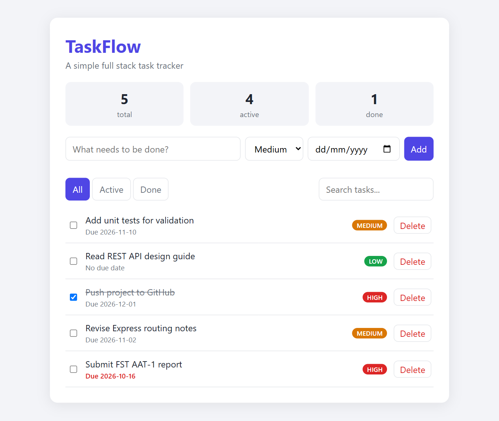
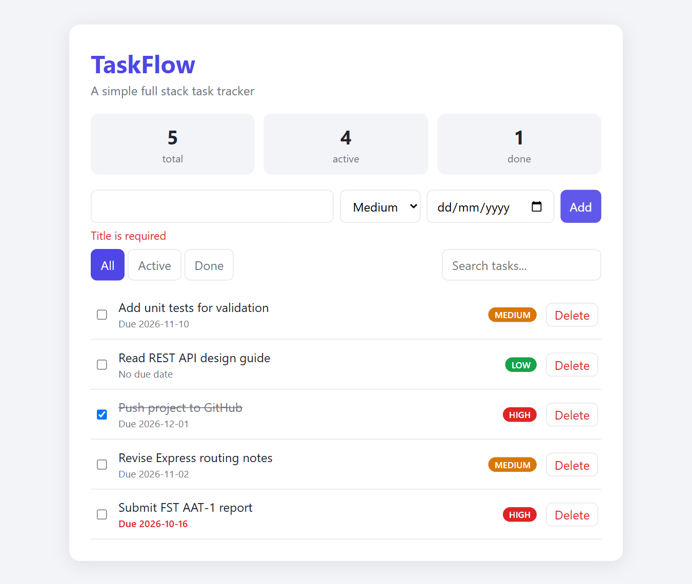
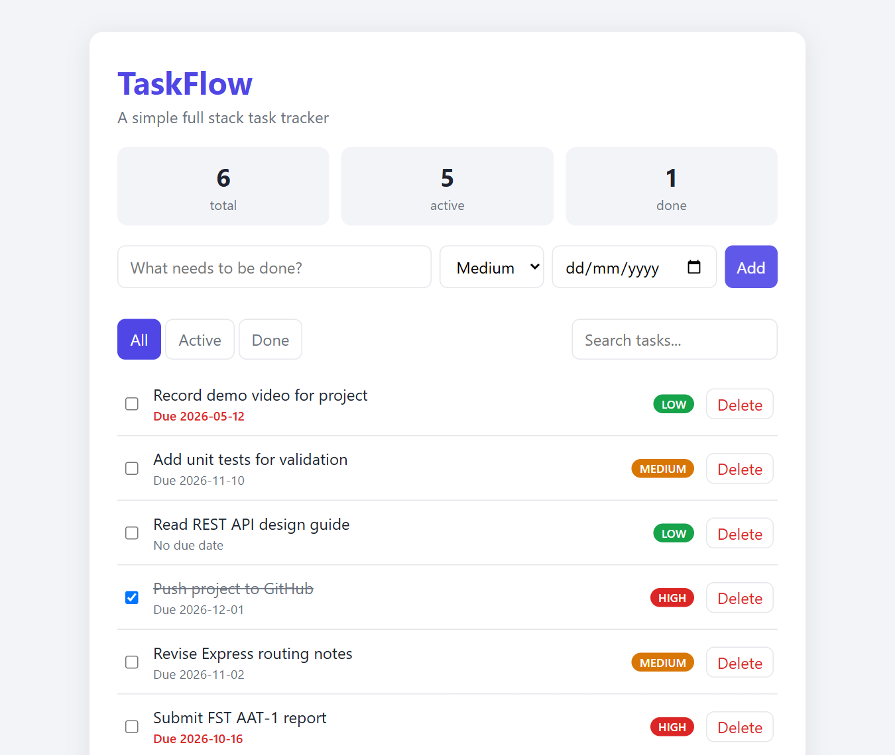
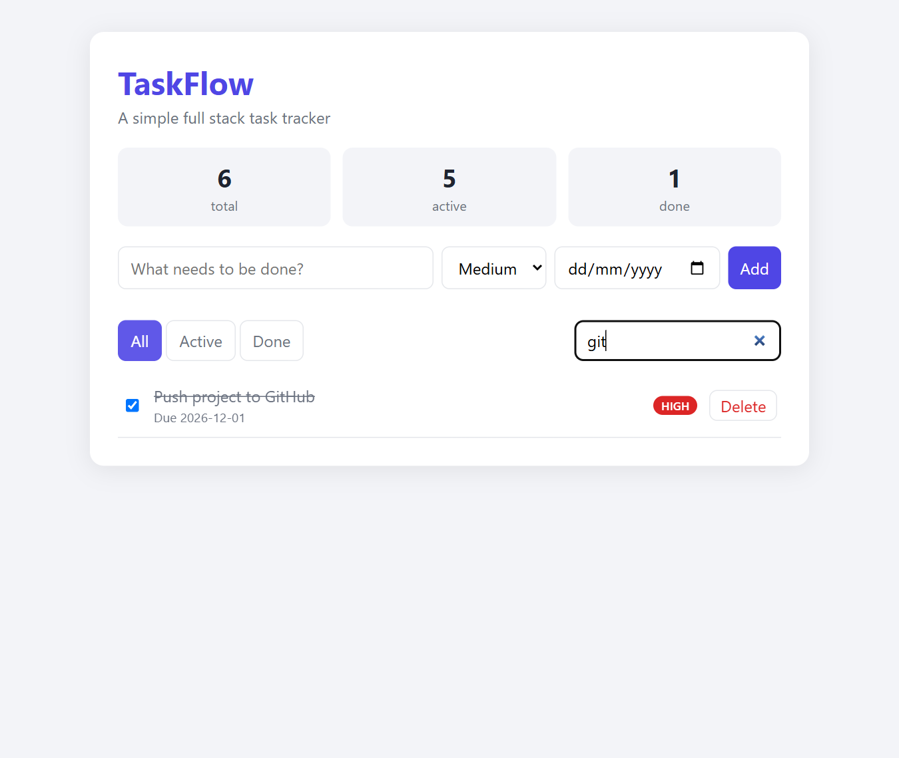

# TaskFlow – Full Stack Task Tracker

**Course:** Full Stack Technologies (FST) · **Assessment:** AAT-1 (Portfolio-Driven)

## Objective
Build and showcase a practical full stack web application: a REST API backend with a responsive browser frontend, input validation, persistence and automated tests.

## Description
TaskFlow lets a user create tasks with a priority and due date, tick them off, delete them, filter by status (All / Active / Done), search by title, and see live totals. Overdue tasks are highlighted in red.

- **Backend:** Node.js + Express REST API, validation of all input, JSON-file persistence.
- **Frontend:** HTML, CSS and vanilla JavaScript (Fetch API), with HTML-escaping to prevent XSS.
- **Tests:** Node's built-in test runner against the live API.

## Tools / Technologies
Node.js 18+, Express 4, HTML5, CSS3, JavaScript (ES2020), `node:test`, Git & GitHub.

## Project Structure
```
├── app.js            # Express app factory (routes + validation)
├── server.js         # Entry point
├── public/           # Frontend (index.html, style.css, app.js)
├── test/api.test.js  # API tests
└── docs/screenshots/ # Output screenshots
```

## REST API
| Method | Endpoint | Description |
|---|---|---|
| GET | `/api/tasks?status=active\|done&q=text` | List / filter / search tasks |
| POST | `/api/tasks` | Create a task `{title, priority, dueDate}` |
| PUT | `/api/tasks/:id` | Update fields (e.g. `{done:true}`) |
| DELETE | `/api/tasks/:id` | Delete a task |
| GET | `/api/stats` | `{total, active, done}` |

## Execution Steps
```bash
git clone https://github.com/Veins19/FST_AAT1.git
cd FST_AAT1
npm install
npm start        # open http://localhost:3000
npm test         # run API tests
```

## Output
| Home | Validation error |
|---|---|
|  |  |

| Task added | Done filter | Search |
|---|---|---|
|  |  |  |

## Author
Veins19
